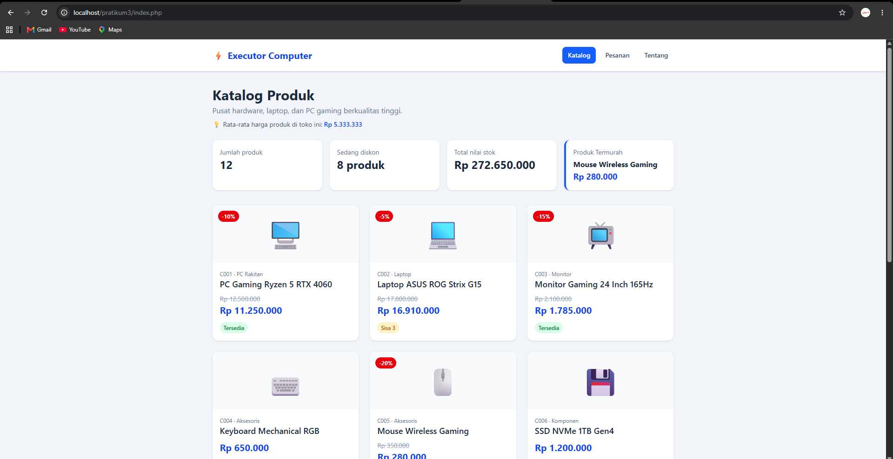
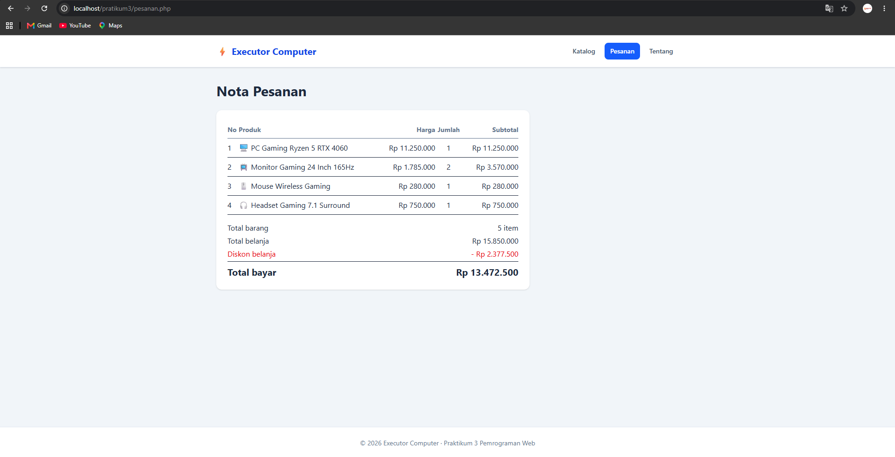
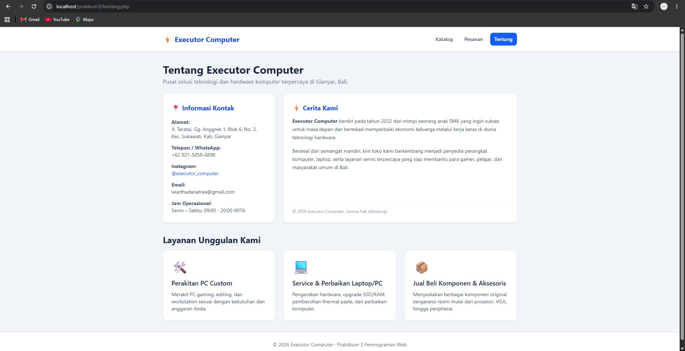

# Praktikum 3 — Katalog Produk Toko Komputer / E-Commerce

**Nama:** I Gede Wiartha Danatrea  
**NIM:** 2501020042  
**Mata Kuliah:** Pemrograman Web  

---

## 📌 Deskripsi Proyek

Proyek ini merupakan aplikasi web katalog produk interaktif untuk toko **Executor Computer** yang dibuat menggunakan **PHP Native** dan **Tailwind CSS**. Data produk dikelola secara dinamis menggunakan array multidimensi dan fungsi-fungsi terpisah untuk kalkulasi diskon, status stok, serta ringkasan total nota belanja.

---

## 🛠️ Fitur Utama

1. **Katalog Produk Dinamis:** Menampilkan 12 daftar produk komputer lengkap dengan status stok, badge diskon, dan harga akhir.
2. **Modularisasi File:** Menggunakan pemisahan struktur file yang rapi (`header.php`, `footer.php`, `data.php`, dan `fungsi.php`).
3. **Nota Pesanan:** Perhitungan otomatis subtotal, diskon belanja tambahan, dan kalkulasi total bayar.
4. **Halaman Tentang Toko (`tentang.php`):** Berisi informasi profil toko, alamat lengkap di Jl. Teratai, Gg. Anggrek 1, Blok 6, No. 3, Sukawati, Kab. Gianyar, kisah pendirian toko sejak 2022, akun Instagram (@executor_computer), serta layanan unggulan.

---

## ⭐ Tantangan (Pengayaan) yang Dikerjakan

* **Produk Termurah:** Menambahkan kotak ringkasan khusus untuk menampilkan produk dengan harga terendah setelah diskon di halaman katalog[cite: 6].
* **Rata-rata Harga:** Menampilkan informasi rata-rata harga produk keseluruhan di bagian atas katalog[cite: 6].
* **Halaman Tentang Toko:** Membuat halaman tambahan profil lengkap dengan daftar layanan yang disusun menggunakan struktur array[cite: 7].

---

## 📸 Dokumentasi Screenshot (Localhost)

### 1. Halaman Katalog (index.php)
[cite: 6]

### 2. Halaman Pesanan (pesanan.php)
[cite: 4]

### 3. Halaman Tentang Toko (tentang.php)
[cite: 7]